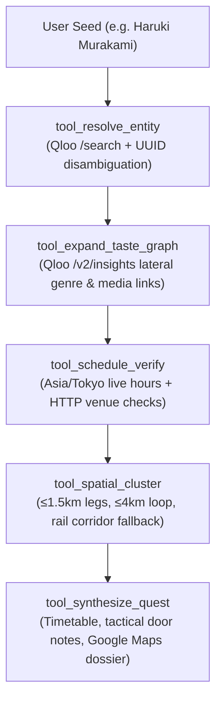

# SideQuest

An autonomous cultural concierge that turns personal obsessions into walkable Tokyo quests using Qloo's Taste Graph.

[Open the prototype](https://sidequest-tokyo-ckx.ckx-1994.chatgpt.site/) · [2-minute demo video script](DEMO.md) · [Pitch deck](https://chatgpt.com/space/page_d24a68d287908191ab7cfdce84212ace)

Tokyo holds thousands of narrow backstreets and niche cultural spaces. Standard map searches surface tourist hubs with ninety-minute queues. Generic large language model itinerary planners hallucinate non-existent coffee shops or pair venues on opposite sides of the prefecture with impossible walking times.

SideQuest takes a single cultural spark, such as an author, a synthesizer pioneer, an indie film director, or a modernist sculptor, and runs an autonomous agent pipeline to build a three-stop walking circuit with verified Tokyo opening hours and tactical door notes.

---

## The 5-Tool Agentic Architecture

The scouting engine lives in [lib/agent-tools.ts](lib/agent-tools.ts), exporting explicit schemas and typed tool functions designed for hackathon evaluation:



1. **`tool_resolve_entity`**: Queries Qloo `/search`, validates candidate UUIDs via Zod, and resolves exact matches. When a seed has multiple interpretations, such as an eponymous artist versus an album, it automatically selects the primary artist or prompts the user for clarification.
2. **`tool_expand_taste_graph`**: Uses Qloo `/v2/insights` to expand cross-domain taste associations across music genres and media types. It computes direct venue affinity and bridges seed tags into reviewed venue categories.
3. **`tool_schedule_verify`**: Enforces strict Asia/Tokyo timezone calculations. It rejects closed venues, checks published opening windows, and fetches official venue pages live over HTTP to catch unindexed temporary closures.
4. **`tool_spatial_cluster`**: Groups candidates into tight walking circuits where every individual leg is 1.5 km or less and the total loop is under 4 km. If a neighborhood cluster has fewer than three viable venues, it widens along direct transit corridors such as the Inokashira or Odakyu lines.
5. **`tool_synthesize_quest`**: Compiles the final itinerary with arrival timetables, authored missions, insider door notes, and an exportable Google Maps route.

The route handler at `app/api/quests/route.ts` runs these tools sequentially and streams live progress to the frontend over `text/event-stream` using newline-delimited JSON.

---

## Why Qloo Needs Curated Ground Truth

Qloo's collaborative filtering graph is effective at calculating semantic affinities between artists, films, books, and musical subgenres. An open-ended query to Qloo for Tokyo venues returns commercial corporate concert halls and international hotel lobbies. Qloo does not maintain geocoded records for twenty-seat vinyl listening bars in Dogenzaka or vintage photobook galleries in Jimbocho.

SideQuest solves this catalog density challenge through a hybrid design:
- We maintain a curated, source-reviewed catalog of 100 Tokyo cultural spaces across iconic neighborhoods such as Jimbocho, Shimokitazawa, Shibuya, and Aoyama.
- Qloo calculates the mathematical affinity between the visitor's cultural seed and these vetted venues.
- Qloo provides the taste expansion; our local catalog guarantees physical ground truth, accurate coordinates, and real entrance intelligence.

---

## 4 Golden Demonstration Seeds

The repository includes automated integration tests ensuring these four flagship seeds produce distinct three-stop circuits across different Tokyo neighborhoods with zero venue overlap:

| Seed | Cultural Focus | District | Walking Circuit | Verified Stops |
| :--- | :--- | :--- | :--- | :--- |
| **Haruki Murakami** | Literature, Showa Kissaten, Rare Books | Jimbocho | 20 min (368 m) | 1. Kanda Brazil (coffee, 12:15)<br/>2. Bohemian's Guild (books, 13:07)<br/>3. Komiyama Tokyo (books, 13:59) |
| **Yellow Magic Orchestra** | Electronic Music, Synthesizers, Vinyl Culture | Shimokitazawa | 50 min (1,196 m) | 1. Bear Pond Espresso (coffee, 12:15)<br/>2. Reload (art / design, 13:10)<br/>3. Pianola Records (dig, 14:16) |
| **Wong Kar-wai** | Cinema, Film Noir, Low-Lit Alley Bars | Shibuya | 53 min (2,609 m) | 1. GALLERY CONCEAL SHIBUYA (art, 15:45)<br/>2. SHIBUYA PUBLISHING & BOOKSELLERS (books, 16:53)<br/>3. Bar Music (listen, 18:02) |
| **Isamu Noguchi** | Sculpture, Industrial Design, Modernist Architecture | Harajuku & Aoyama | 55 min (1,674 m) | 1. KOFFEE MAMEYA (coffee, 12:15)<br/>2. UTRECHT (books, 13:18)<br/>3. WATARI-UM (art, 14:28) |

Every stop includes tactical door notes detailing floor levels, cash policies, and atmosphere guidance without speculative fluff.

---

## Field Guide Interface

The user interface uses the Google Stitch field guide layout:
- **Spark Input with Quick-Pick Chips**: Tap any of the four golden seeds or type any cultural entity.
- **Cultural Dispersion Dial**: Choose between Tight Orbit, Curious Detour, and Wild Drift to control taste exploration radius.
- **Live Streamed Agent Trace**: Watch monospace tool executions, runtime telemetry, and autonomous decisions stream live as Qloo executes.
- **Quest Dossier**: Visual itinerary cards displaying sequential stop numbers, arrival timetables, directional walking connectors, and door notes.
- **One-Click Navigation**: Export the complete walking circuit directly into Google Maps with pre-populated waypoints and origin-destination loop closure.

---

## Run Locally

Requires Node 22.13+.

1. Install dependencies:
   ```bash
   npm run install:ci
   ```
2. Create `.dev.vars` with your Qloo API key:
   ```bash
   QLOO_API_KEY="your-qloo-key-here"
   ```
3. Run the development server:
   ```bash
   npm run dev
   ```
4. Run the automated test suite:
   ```bash
   npm test
   ```

All 187 automated unit and integration tests execute in approximately 1.2 seconds, covering tool definitions, entity disambiguation, timetable verification, spatial clustering, and the golden demonstration seeds.
